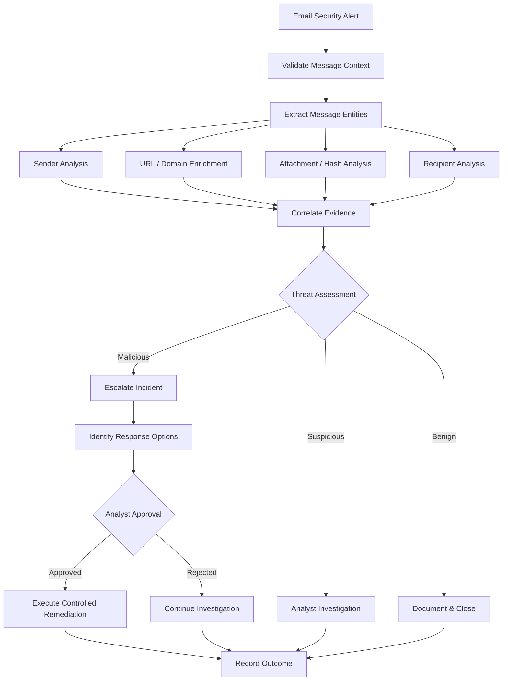

# Email Security Investigation & Response

## Overview

Email Security Investigation & Response is a SOAR reference design for investigating suspicious email activity, enriching indicators, correlating related security evidence, and coordinating analyst-controlled remediation.

The workflow is designed for phishing, malicious-message, suspicious-sender, and related email-security investigations.

## Security Problem

Email investigations often require analysts to pivot across multiple data sources before determining whether a message is benign, suspicious, or malicious.

Common investigation tasks include:

- Identify the sender and recipients
- Inspect message metadata
- Extract URLs, domains, IP addresses, and attachments
- Analyze file hashes and indicators
- Review sender reputation
- Identify additional recipients of the message
- Correlate endpoint or identity activity
- Determine whether remediation is necessary
- Remove malicious messages or block indicators

Automating repeatable investigation steps can reduce analyst effort while preserving human control over disruptive response actions.

## Objectives

The workflow is designed to:

1. Receive an email-security alert.
2. Validate message and investigation context.
3. Extract relevant entities and indicators.
4. Enrich URLs, domains, IP addresses, senders, and file hashes.
5. Correlate related security activity.
6. Determine the investigation path.
7. Identify potentially affected users.
8. Escalate confirmed or likely malicious activity.
9. Require authorization for remediation actions.
10. Record investigation evidence and outcome.

## High-Level Workflow



## Investigation Entities

The workflow can extract and investigate:

- Sender email address
- Sender domain
- Recipient accounts
- Message identifiers
- URLs
- Domains
- Source IP addresses
- Attachment names
- File hashes
- Subject and message metadata

## Enrichment

### Sender & Domain Context

Potential checks include:

- Sender reputation
- Domain reputation
- Known malicious infrastructure
- External versus internal sender
- Authentication results
- Historical sender activity

### URL & IP Analysis

Extracted indicators can be enriched using available threat-intelligence sources.

Results may include:

- Reputation
- Known malicious classification
- Related threat activity
- Previous sightings
- Confidence information

### Attachment Analysis

Attachment investigation can evaluate:

- File name
- File type
- File hash
- Threat-intelligence results
- Endpoint detections involving the same artifact

### Recipient Analysis

The workflow can determine:

- Original recipients
- Additional users receiving similar messages
- Whether recipients interacted with the message
- Whether related identity or endpoint alerts exist

## Correlation

Email evidence should not be evaluated in isolation.

The workflow can correlate findings with:

- Identity activity
- Endpoint alerts
- SIEM detections
- Threat intelligence
- Related email alerts
- Existing incidents

For example, a suspicious message followed by unusual authentication activity or an endpoint detection represents stronger evidence than the email alert alone.

## Threat Assessment

The workflow can classify the investigation into three broad paths.

**Benign**

Evidence does not currently support malicious activity. Findings are documented and the alert can be closed or monitored.

**Suspicious**

Evidence is incomplete or contains indicators requiring analyst investigation.

**Malicious**

Evidence supports phishing, malware delivery, credential theft, or another confirmed threat. The incident is escalated and response options are prepared.

## Response Options

Depending on available integrations and organizational policy, potential response actions can include:

- Remove malicious messages
- Quarantine messages
- Block malicious sender or domain
- Block malicious URL or IP indicator
- Escalate affected identities for investigation
- Initiate endpoint investigation
- Revoke sessions when credential compromise is suspected
- Create or update a security incident

Disruptive actions remain subject to authorization requirements.

## Human-in-the-Loop Response

```text
Email Alert
    ↓
Automated Investigation
    ↓
Indicator Enrichment
    ↓
Evidence Correlation
    ↓
Threat Assessment
    ↓
Recommended Remediation
    ↓
ANALYST APPROVAL
    ↓
Controlled Response
```

Automated evidence collection does not automatically authorize message deletion, account changes, endpoint containment, or other high-impact actions.

## Microsoft Security Mapping

| Security Function | Example Technology |
| --- | --- |
| Email investigation | Microsoft Defender for Office 365 |
| Cross-domain investigation | Microsoft Defender XDR |
| Identity investigation | Microsoft Entra ID |
| Endpoint correlation | Microsoft Defender for Endpoint |
| SIEM correlation | Microsoft Sentinel |
| Orchestration | SOAR platform / security automation layer |

## Failure Handling

The workflow should account for:

- Missing message identifiers
- Deprecated or unavailable commands
- Authentication failures
- Insufficient permissions
- Threat-intelligence service failures
- Missing attachment or URL data
- Incomplete recipient information
- Response-action failures

Missing enrichment is treated as unavailable evidence rather than evidence that an indicator is safe.

## Security Guardrails

- Use least-privilege API permissions.
- Validate message and recipient identifiers before remediation.
- Preserve evidence supporting the investigation decision.
- Treat threat-intelligence results as evidence, not absolute truth.
- Separate investigation from remediation.
- Require authorization for disruptive actions.
- Record remediation results.
- Surface failed or unavailable integrations.
- Avoid storing credentials or secrets in workflow code.

## Testing Scenarios

| Scenario | Expected Workflow Behavior |
| --- | --- |
| Benign message | Document findings and close |
| Suspicious sender | Enrich and route to analyst |
| Malicious URL | Escalate investigation |
| Malicious attachment | Escalate and prepare response |
| Multiple affected recipients | Expand investigation scope |
| Threat-intelligence API unavailable | Continue safely and surface failure |
| Message lookup unavailable | Route for manual investigation |
| Remediation requested | Require authorization |
| Remediation command fails | Record failure and alert analyst |

## Engineering Considerations

Email-security automation depends on more than playbook logic.

Production workflows must account for:

- Connector authentication
- API permissions
- Command availability
- Deprecated commands
- Message identifiers
- Integration health
- Telemetry availability
- Rate limits
- Response prerequisites
- Error handling
- Auditability

These operational dependencies directly affect whether an automated investigation or response workflow can execute successfully.

## Technologies & Concepts

- Email Security
- Phishing Investigation
- SOAR
- Microsoft Defender for Office 365
- Microsoft Defender XDR
- Microsoft Sentinel
- Microsoft Defender for Endpoint
- Microsoft Entra ID
- Threat Intelligence
- IOC Enrichment
- Incident Response
- Security Orchestration
- Human-in-the-Loop Automation

## Portfolio Implementation

This case study is a sanitized reference architecture demonstrating email-security investigation and response patterns.

It contains no production email data, customer information, tenant identifiers, credentials, proprietary playbook exports, or employer-confidential information.

## Status

**Reference Design / Case Study**

The investigation flow, enrichment model, evidence correlation, response boundaries, failure handling, and security controls are documented for portfolio demonstration.
