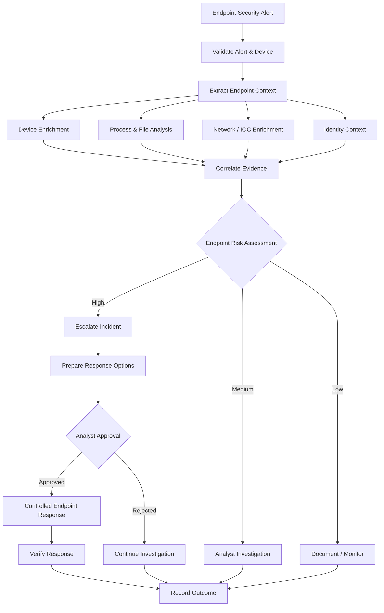

# Endpoint Investigation & Response

## Overview

Endpoint Investigation & Response is a SOAR reference design for investigating suspicious endpoint activity, correlating device and threat context, and coordinating controlled containment and remediation.

The workflow demonstrates how endpoint alerts can move from initial detection through automated enrichment and evidence collection to analyst-reviewed response.

## Security Problem

Endpoint alerts often require analysts to collect context from several systems before deciding whether a device represents an active security threat.

Common investigation tasks include:

- Identify the affected endpoint
- Determine device ownership and management state
- Review alert and detection context
- Investigate suspicious processes or files
- Extract and enrich indicators
- Correlate related user activity
- Identify related alerts or incidents
- Determine whether containment is required
- Coordinate remediation

Automating repeatable investigation tasks can accelerate triage while preserving analyst control over disruptive endpoint actions.

## Objectives

The workflow is designed to:

1. Receive an endpoint-security alert.
2. Validate the affected device and alert context.
3. Extract endpoint entities and indicators.
4. Enrich device, user, process, file, and network context.
5. Correlate related security evidence.
6. Assess endpoint risk.
7. Escalate suspicious or malicious activity.
8. Prepare containment or remediation options.
9. Require authorization for disruptive actions.
10. Record investigation and response outcomes.

## High-Level Workflow



## Investigation Context

### Device Context

The workflow can collect:

- Device ID
- Hostname
- Operating system
- Device ownership
- Management state
- Security health
- Last-seen information
- Associated user
- Existing endpoint alerts

### Process & File Context

Potential investigation data includes:

- Process name
- Parent process
- Command line
- File name
- File path
- File hash
- Digital signature information
- Related detections

### Network Context

Endpoint network activity can provide:

- Source and destination IP addresses
- Domains
- URLs
- Network connections
- Threat-intelligence results
- Known malicious infrastructure

### Identity Context

Endpoint activity can be correlated with:

- Logged-in user
- Identity risk
- Recent authentication activity
- Privileged account status
- Related identity alerts

## Evidence Correlation

The workflow combines endpoint evidence with other available security telemetry.

Potential correlations include:

- Same file hash observed on multiple devices
- Suspicious process followed by outbound network activity
- Endpoint alert associated with risky identity activity
- Multiple alerts affecting the same host
- Known malicious indicator observed on the endpoint
- Related SIEM or XDR incidents

Correlation provides stronger investigation context than evaluating individual detections independently.

## Endpoint Risk Assessment

Risk can be influenced by:

- Original alert severity
- Malware or file reputation
- Suspicious process behavior
- Known malicious indicators
- Device criticality
- Privileged-user involvement
- Related identity risk
- Number of correlated alerts
- Endpoint security state

The evidence contributing to an escalation should remain visible to the analyst.

## Response Options

Potential endpoint-response actions can include:

- Isolate endpoint
- Collect investigation package
- Initiate antivirus scan
- Quarantine malicious file
- Stop malicious process
- Block confirmed indicator
- Escalate affected identity
- Create or update incident
- Initiate remediation workflow

Response availability depends on platform capabilities, permissions, and organizational policy.

## Human-in-the-Loop Response

Potentially disruptive endpoint actions remain behind an authorization boundary.

```text
Endpoint Detection
       ↓
Automated Enrichment
       ↓
Evidence Correlation
       ↓
Risk Assessment
       ↓
Recommended Response
       ↓
ANALYST APPROVAL
       ↓
Containment / Remediation
       ↓
Response Verification
```

Endpoint isolation or other disruptive actions should not occur solely because a single automated signal crosses a threshold.

## Microsoft Security Mapping

| Security Function | Example Technology |
| --- | --- |
| Endpoint detection & response | Microsoft Defender for Endpoint |
| Cross-domain investigation | Microsoft Defender XDR |
| SIEM correlation | Microsoft Sentinel |
| Identity correlation | Microsoft Entra ID |
| Email correlation | Microsoft Defender for Office 365 |
| Orchestration | SOAR platform / security automation layer |

## Failure Handling

The workflow should account for:

- Endpoint not found
- Device offline
- Missing device identifier
- Endpoint integration unavailable
- Authentication failure
- Insufficient permissions
- Threat-intelligence service unavailable
- Response command unavailable
- Containment action failure
- Response verification failure

A failed enrichment or response step is surfaced to the analyst and does not silently convert into a successful result.

## Security Guardrails

- Validate endpoint identity before executing response.
- Use least-privilege permissions.
- Separate investigation from containment.
- Require authorization for disruptive actions.
- Preserve evidence supporting escalation.
- Record response requests and outcomes.
- Verify whether containment or remediation succeeded.
- Treat unavailable telemetry as unknown rather than safe.
- Never embed credentials in workflow code.

## Testing Scenarios

| Scenario | Expected Workflow Behavior |
| --- | --- |
| Low-risk endpoint alert | Document and monitor |
| Suspicious process | Enrich and route to analyst |
| Known malicious file | Escalate investigation |
| Malicious network indicator | Correlate and escalate |
| Multiple related detections | Increase investigation priority |
| Endpoint offline | Surface limitation |
| Enrichment unavailable | Continue safely with available evidence |
| Isolation requested | Require authorization |
| Isolation fails | Record failure and notify analyst |
| Response succeeds | Verify and record outcome |

## Engineering Considerations

Endpoint-response automation requires coordination between workflow logic and platform capabilities.

Production implementations must account for:

- Connector health
- Authentication
- API permissions
- Device identifiers
- Command availability
- Endpoint connectivity
- Response prerequisites
- API behavior
- Failure handling
- Auditability
- Verification of response actions

A workflow is not complete merely because the orchestration path exists; the underlying integrations and response dependencies must also be operational.

## Technologies & Concepts

- Endpoint Detection & Response
- SOAR
- Microsoft Defender for Endpoint
- Microsoft Defender XDR
- Microsoft Sentinel
- Microsoft Entra ID
- Threat Intelligence
- IOC Enrichment
- Incident Response
- Security Orchestration
- Detection Engineering
- Human-in-the-Loop Automation

## Portfolio Implementation

This case study is a sanitized reference architecture demonstrating endpoint investigation, evidence correlation, and controlled response patterns.

It contains no production endpoint data, customer information, credentials, tenant identifiers, proprietary playbook exports, or employer-confidential information.

## Status

**Reference Design / Case Study**

The endpoint investigation flow, evidence model, response boundaries, failure handling, and security controls are documented for portfolio demonstration.
