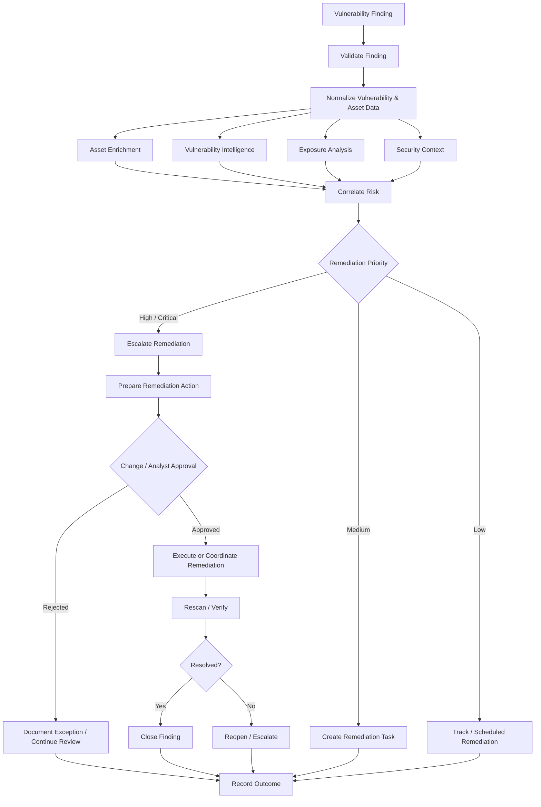

# Vulnerability Investigation & Remediation

## Overview

Vulnerability Investigation & Remediation is a security automation reference design for enriching vulnerability findings, correlating asset and security context, prioritizing remediation, and coordinating controlled remediation and validation.

The workflow demonstrates how vulnerability-management data can be transformed from a raw scanner finding into an actionable security workflow using asset context, severity, exposure, exploitability, and operational risk.

## Security Problem

Vulnerability scanners can generate large volumes of findings, but scanner severity alone does not always indicate which vulnerability should be addressed first.

Security teams may need to determine:

- Which asset is affected
- Whether the asset is business-critical
- Whether the system is externally exposed
- Whether exploitation is known or likely
- Whether related security detections exist
- Whether the vulnerability is duplicated across sources
- Which remediation action is appropriate
- Whether remediation succeeded

Automating enrichment and prioritization can reduce manual analysis while preserving control over production changes.

## Objectives

The workflow is designed to:

1. Receive a vulnerability finding.
2. Validate the vulnerability and affected asset.
3. Normalize scanner and asset data.
4. Enrich the finding with asset and threat context.
5. Evaluate severity, exploitability, exposure, and business impact.
6. Assign remediation priority.
7. Route findings to the appropriate remediation path.
8. Track remediation activity.
9. Validate remediation through rescan or verification.
10. Record the final outcome.

## High-Level Workflow



## Data Normalization

Vulnerability workflows frequently receive data from systems with different schemas and identifiers.

A normalized finding can include:

- Vulnerability identifier
- CVE
- Scanner severity
- CVSS score
- Affected asset
- Hostname
- IP address
- Operating system
- Application
- Application version
- Detection timestamp
- Exploitability context
- Exposure information
- Remediation guidance

Normalization allows downstream prioritization logic to operate consistently across different data sources.

## Asset Context

Asset enrichment can include:

- Asset identifier
- Hostname
- IP address
- Operating system
- Device type
- Business owner
- Business criticality
- Environment
- Internet exposure
- Security tooling coverage

An identical vulnerability may require different remediation priority depending on the affected asset.

## Vulnerability Intelligence

Additional vulnerability context can include:

- CVE information
- CVSS score
- Known exploitation
- Public exploit availability
- Vendor remediation guidance
- Patch availability
- Threat-intelligence context

Scanner severity is treated as one input rather than the complete risk decision.

## Risk Prioritization

Prioritization can consider:

- Vulnerability severity
- Exploitability
- Asset criticality
- Internet exposure
- Known exploitation
- Existing security controls
- Related security activity
- Availability of remediation

Example:

```text
Critical Vulnerability
        +
Internet-Exposed Asset
        +
Known Exploitation
        +
High Business Criticality
        ↓
URGENT REMEDIATION
```

The evidence contributing to the priority should remain visible to analysts and remediation teams.

## Remediation Paths

Depending on the finding and affected technology, remediation can include:

- Apply vendor patch
- Upgrade vulnerable software
- Remove unsupported software
- Change configuration
- Disable vulnerable service
- Apply compensating control
- Isolate affected asset
- Accept documented risk
- Create remediation ticket
- Schedule maintenance activity

Automation can coordinate these activities without assuming every remediation action should execute autonomously.

## Human-in-the-Loop Control

Changes to production systems may create operational risk.

```text
Vulnerability Finding
        ↓
Automated Enrichment
        ↓
Risk Prioritization
        ↓
Recommended Remediation
        ↓
CHANGE / ANALYST APPROVAL
        ↓
Remediation
        ↓
Verification
```

Approval requirements can vary based on asset criticality, remediation type, and organizational change-management policy.

## Verification

A remediation workflow should not consider a vulnerability resolved simply because an action was requested.

Verification can include:

- Vulnerability rescan
- Asset inventory validation
- Software-version validation
- Configuration verification
- Security-control validation

Failed verification returns the finding to investigation or remediation rather than incorrectly closing it.

## Example Integration Model

| Security Function | Example Technology |
| --- | --- |
| Vulnerability management | Tenable |
| Endpoint / asset inventory | Endpoint or RMM platform |
| Security correlation | SIEM / XDR |
| Workflow orchestration | SOAR platform |
| Data transformation | Python / API automation |
| Remediation tracking | Ticketing / workflow platform |

## Failure Handling

The workflow should account for:

- Missing asset identifiers
- Duplicate assets
- Missing software versions
- Scanner API unavailable
- Asset inventory unavailable
- Authentication failure
- Insufficient permissions
- Remediation command unavailable
- Rescan unavailable
- Verification failure

Incomplete information is surfaced rather than silently interpreted as low risk.

## Security Guardrails

- Validate asset identity before remediation.
- Use least-privilege integration permissions.
- Separate prioritization from remediation execution.
- Require approval where remediation can affect production.
- Preserve evidence supporting priority decisions.
- Record remediation requests and outcomes.
- Verify remediation before closing findings.
- Treat missing data as unknown rather than safe.
- Never embed credentials in workflow code.

## Testing Scenarios

| Scenario | Expected Workflow Behavior |
| --- | --- |
| Low-risk internal finding | Track according to policy |
| Critical vulnerability | Escalate remediation |
| Internet-exposed vulnerable asset | Increase priority |
| Known exploited vulnerability | Increase priority |
| Critical business asset | Increase scrutiny |
| Missing asset context | Flag for investigation |
| Duplicate asset record | Detect and handle duplication |
| Remediation requested | Apply approval policy |
| Rescan still detects vulnerability | Reopen or escalate |
| Verification succeeds | Close finding |

## Engineering Considerations

Vulnerability automation requires reliable relationships between scanner findings, assets, applications, and remediation systems.

Production implementations must account for:

- Asset identity and deduplication
- Data normalization
- Application mapping
- Scanner integrations
- API authentication
- Connector health
- Missing or inconsistent data
- Remediation prerequisites
- Change-management controls
- Rescan capabilities
- Verification
- Auditability

Data quality is therefore part of the security automation problem rather than a separate preprocessing concern.

## Technologies & Concepts

- Vulnerability Management
- SOAR
- Tenable
- Asset Management
- Security Data Normalization
- Python
- REST APIs
- JSON
- Security Orchestration
- Risk Prioritization
- Remediation Automation
- Human-in-the-Loop Control

## Portfolio Implementation

This case study is a sanitized reference architecture demonstrating vulnerability enrichment, asset correlation, remediation prioritization, and verification patterns.

It contains no customer data, production vulnerability findings, credentials, proprietary workflow exports, internal infrastructure details, or employer-confidential information.

## Status

**Reference Design / Case Study**

The normalization model, prioritization architecture, remediation controls, failure handling, and verification process are documented for portfolio demonstration.
